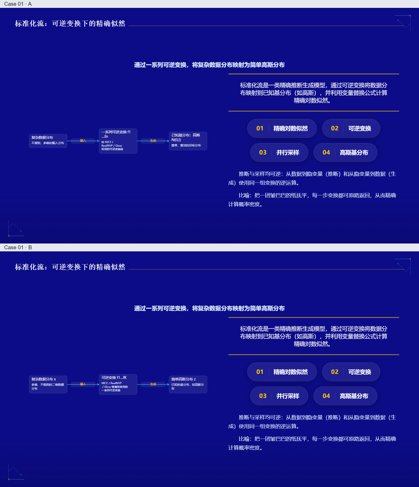
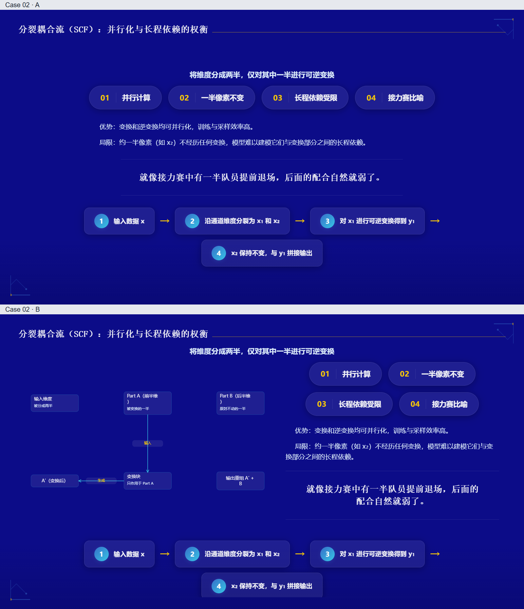
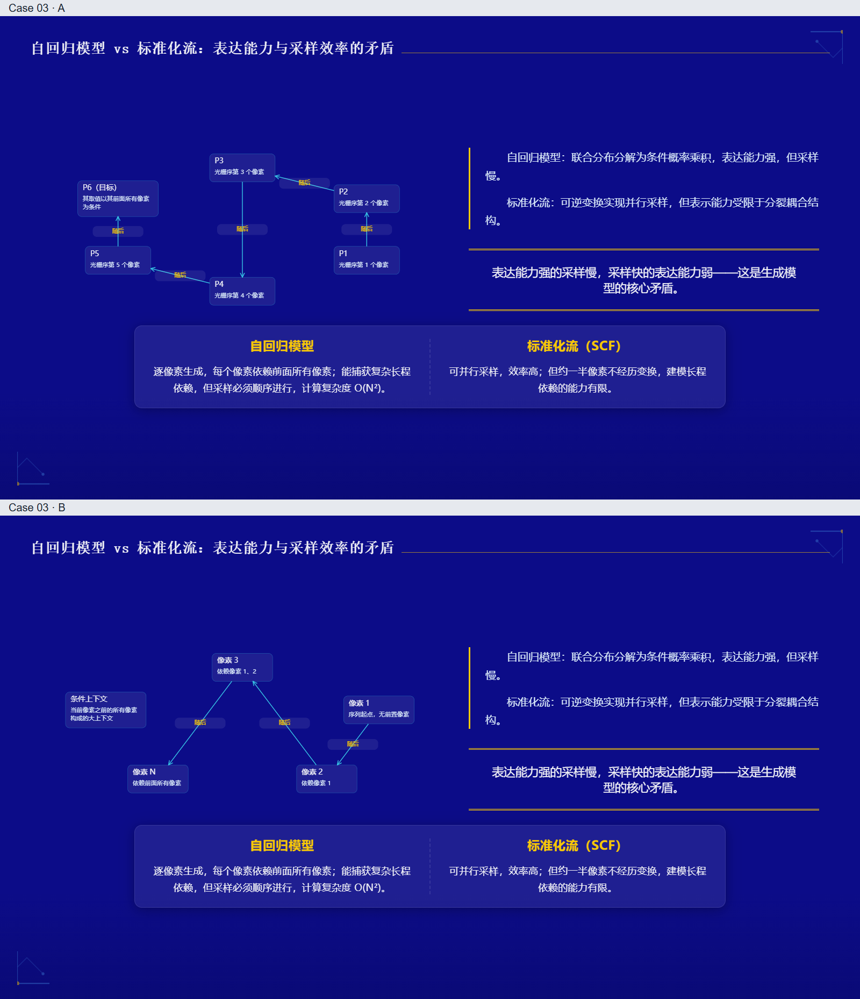
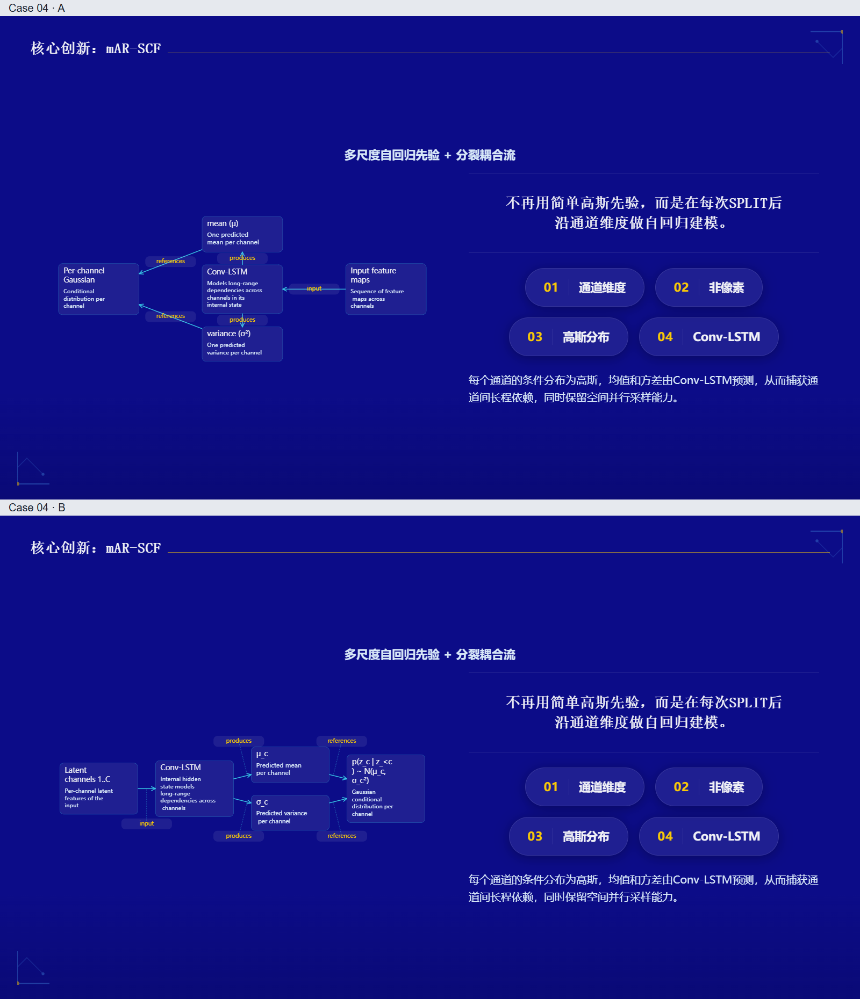
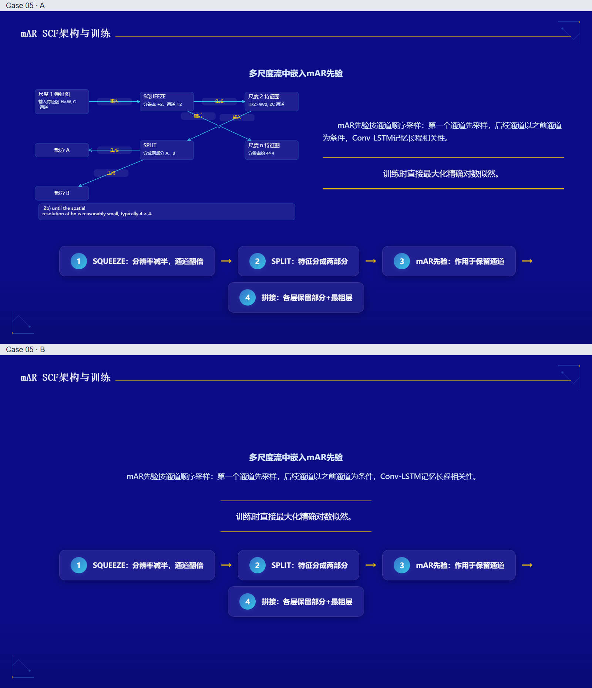
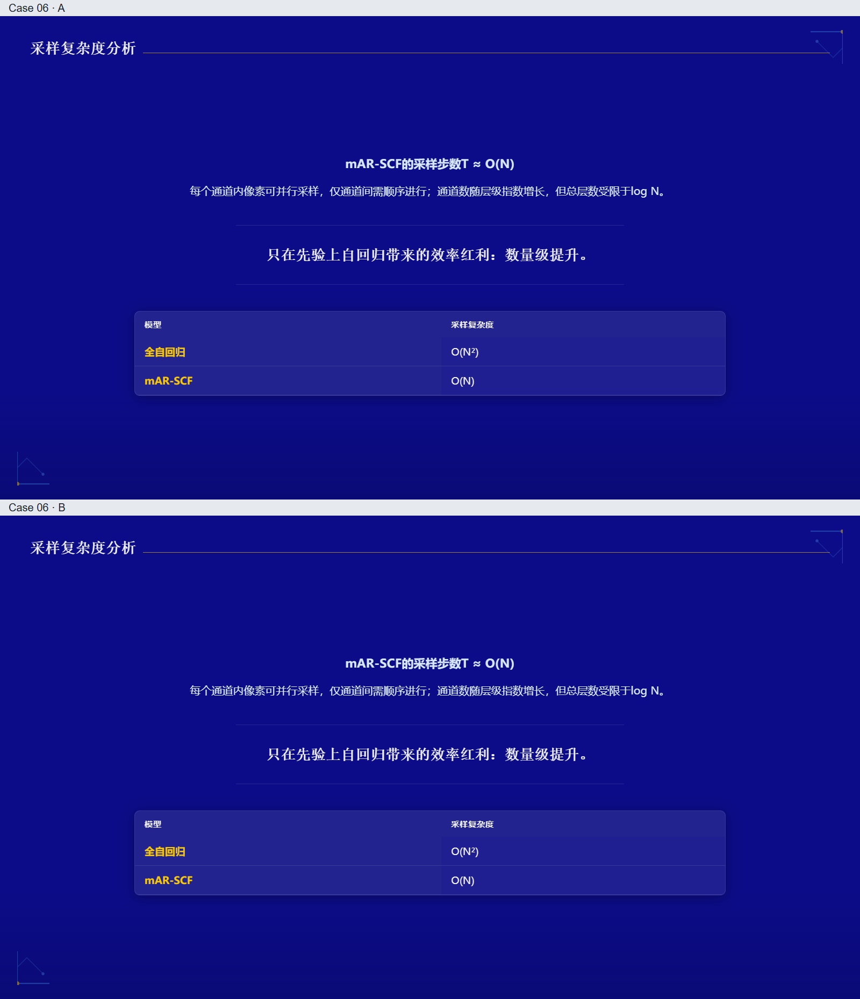
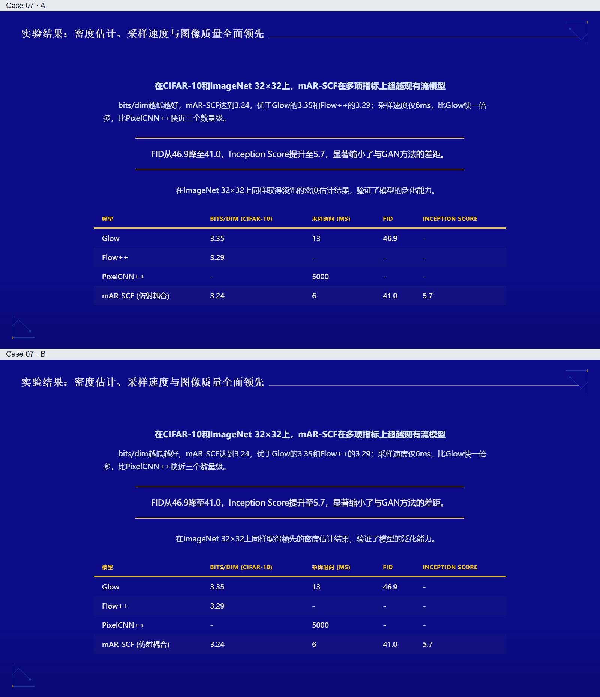
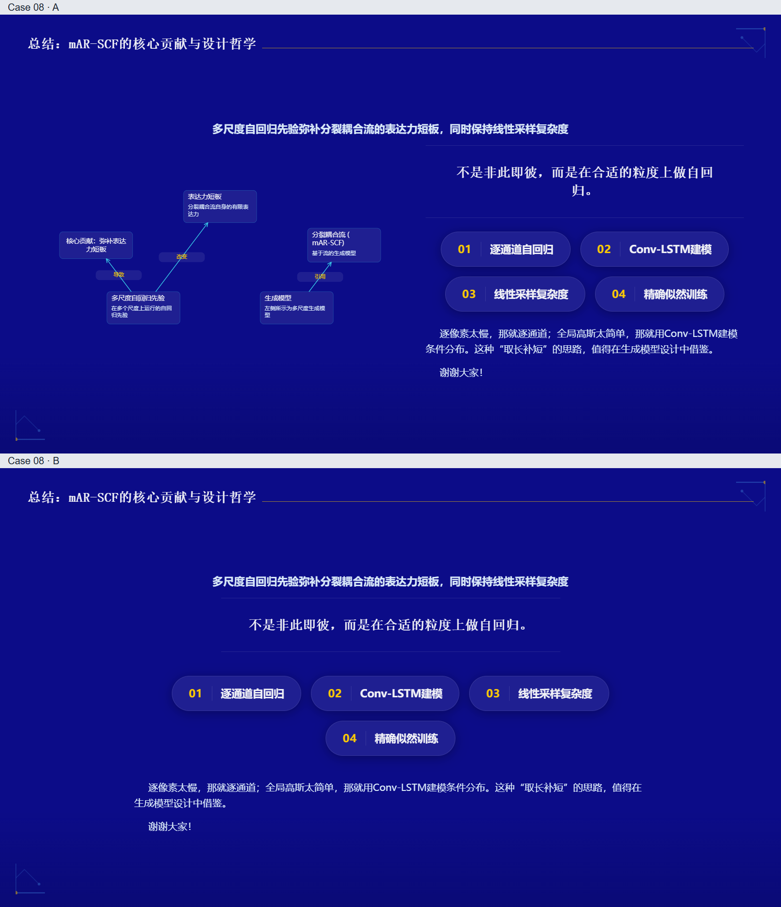
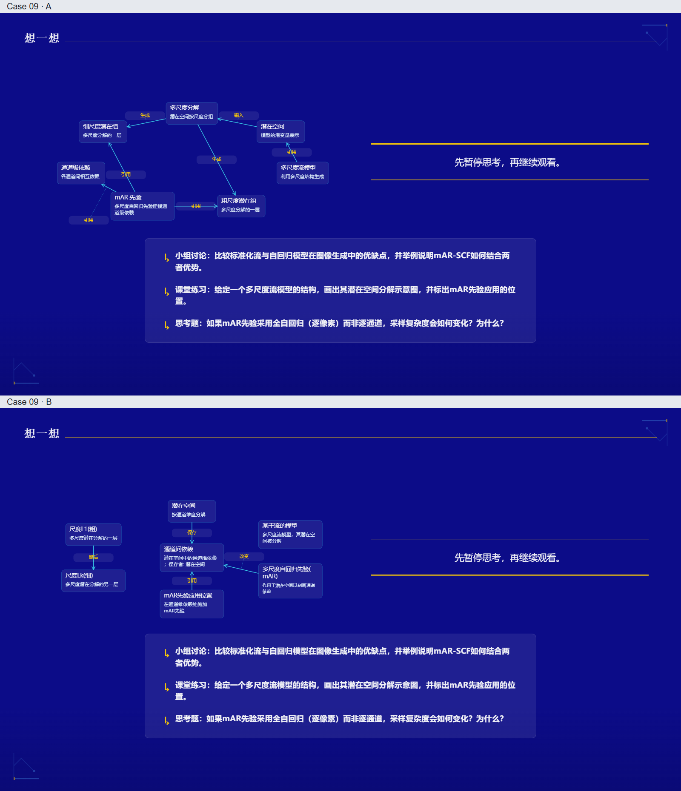
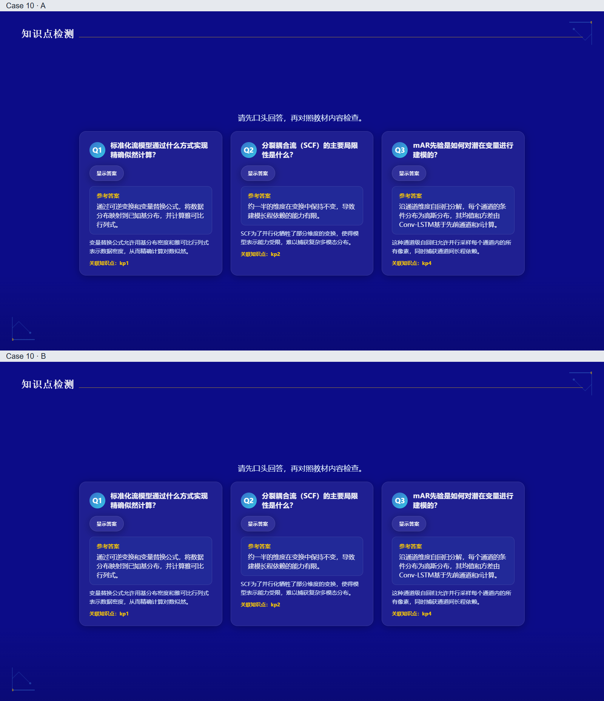

# 教学原则驱动的教材教学视频生成：研究思路与阶段进展汇报

> 面向首次了解项目的导师；这是研究进展汇报，不是论文初稿。资料截止：2026年11月15日。

## 1. 研究背景与目标

教材视频不只是朗读文字、配上图片。学生还要理解对象之间的关系，并在讲解时找到画面重点。本研究关注：系统能否判断何时需要视觉、选择什么视觉，并随讲解突出正确对象和关系。研究目标是提出并比较相应方法；视频能播放不等于方法有效。目前没有学生学习实验，因此不声称提高了学习效果。

## 2. 教学原则与研究问题

- **多媒体原则：**文字与相关图像结合，可能比单独文字更有助于理解；图像应解释知识，不是装饰。
- **连贯原则：**去掉无关或重复信息；教材已有内容足够时不必再加图。
- **时间邻近原则：**讲解与对应视觉应紧密配合，方便建立联系。
- **信号原则：**突出当前重点，同时保留理解关系所需的背景。

| 问题 | 要回答的事 | 研究定位 |
| --- | --- | --- |
| RQ1 视觉需求与获取 | 是否需要补视觉？教材图是否足够？应复用、检索还是生成？ | 方法核心 |
| RQ2 语义绑定与动态引导 | 旁白对应哪些对象和关系？何时强调、何时解除？ | 方法核心 |
| RQ3 证据验证 | 计划的呈现是否执行并在视频中可见？ | 验证机制，不单独作为方法创新 |

## 3. 整体研究思路

教材与教学目标 → 判断视觉需求、选择素材（RQ1） → 旁白对应画面对象与关系（RQ2） → 按真实音频安排强调 → 检查计划、运行与最终画面（RQ3）。

知识命题是需要讲清的一项知识陈述；语义绑定是把它对应到画面中的具体对象或关系。各环节分别评价：对象相关不代表关系讲清，事件执行不代表画面可见。

## 4. 方法设计：Direct 与 Proposed 的区别

**Direct** 是直接模型基线：模型拿到教材依据、当前讲解内容、已有页面和候选视觉后，直接给出决策。**Proposed** 是本研究提出、仍需验证的方法：它把判断拆成有明确依据的步骤，并要求结果可追溯。公平比较时，两者应使用相同输入和选择范围；差异在处理流程，不在谁拿到更多材料。**Baseline** 是比较参照，包括 Direct 和简单规则。

### RQ1：视觉需求与获取

**Direct 的步骤：**

1. 接收知识点、教材内容、页面已有视觉和可用素材候选；
2. 一次性从 `none`、`reuse`、`retrieve`、`generate` 中选择；
3. 返回选择及理由；若选 `generate`，同时给出描述视觉对象、关系和标注的 `generation_prompt`；若选 `retrieve`，给出检索词和验收条件。它不要求先分别检查视觉需求、页面充分性和获取路径。

**Proposed 的步骤：**

1. 当前知识是否有视觉解释需求；
2. 教材文字、原图和页面组件是否已经足够；
3. 若有缺口，现有素材能否复用、是否适合检索；
4. 仍无合适素材时，提出生成请求；
5. 记录依据和不确定性；证据不足时不强行下结论。

四种动作分别表示不补视觉、复用、请求检索、请求生成。Direct 和 Proposed 都可以输出生成描述或检索条件；这些是给后续获取环节执行的内容规格，不是生成好的 SVG/图片。请求也不等于素材已取得或审核通过。Proposed 的五步是同一次决策中的判断顺序，不是五次模型调用。它希望避免“有文字就不需要视觉”或“遇到流程就一定生成图”等直接跳结论的情况；是否优于 Direct 仍待比较验证。

### RQ2：对象绑定与动态强调

两者都要回答同一问题：当前旁白应关注画面中的哪个对象或关系？允许选择多个对象，也允许证据不足时拒绑。

**Direct 的步骤：**

1. 接收旁白命题、教材来源、完整视觉及可寻址候选；
2. 直接选择一个或多个对象/关系作为焦点，或拒绝绑定；
3. 返回选择及理由，不要求依次核对来源定位、关系充分性和联合对象必要性。

**Proposed v1.3 的步骤：**

1. 把旁白中的知识命题对应到教材证据和完整视觉；
2. 从可寻址候选中识别执行者、输入、输出、被操作对象及关系等可能焦点；
3. 判断候选是否有来源支持，以及哪些对象必须共同出现才能表达命题；
4. 选择足够但不过宽的对象集合，并说明它们如何共同表达关系；
5. 程序校验引用和对象 ID；模型辅助检查必要关系是否缺失；
6. 对可定位的错误进行有界修正；仍不确定或证据不足时拒绑；
7. 将接纳目标映射到页面，结合实测音频安排强调与解除，并核对事件和视频画面。

因此，Direct 是“直接选焦点”，Proposed 是“先找证据、分析对象角色与关系，再选择并检查”。Proposed 预期能减少无依据绑定和关系漏选，但会增加调用、耗时和误拒风险。模型核查不是客观证明；e01 中 Proposed 可修正、Direct 只预测一次，比较预算并不相等。

### RQ3：核对最终呈现

计划了什么 → 编译成什么事件 → 浏览器是否执行 → MP4 是否清楚可见。

日志中的 executed 只能证明程序执行，不能证明对象选择正确或教学呈现充分。

## 5. 系统实现与当前进展

produce 是从教材到视频的工程入口，不是研究方法。f11 为315.93秒有声 MP4，复用了 f09 的11页分镜、配音和绑定结果；修复事件编译后重新录制，不能称为首次全自动运行。全片解码通过，但未连续完整听看。

| 环节 | 实际结果 | 限制 |
| --- | --- | --- |
| 普通视觉增强 | 27项：none 23、generate 4；4张 SVG 进入第1、3、4、9页 | 1张 ACCEPT，3张带告警使用；reuse/retrieve 为0 |
| Proposed v1.3 | 32项中13组绑定，形成50条 focus | 含拒绑、失败；执行不等于语义正确 |
| 事件与画面 | 114条编译事件有运行对应，50条 focus 执行；抽查13个窗口、39帧 | 部分焦点不明显或持续不足 |
| PDF 原图 | f11 没有原图；后续离线接线提取到8个 Figure 候选 | 尚未在真实成片验证，纯矢量图可能漏提 |

f11 使用普通视觉增强，不是研究版 RQ1 Proposed 实验成绩。e01 另做研究版 Proposed 与 Direct 决策对照，实验条件不同，不能混算。

## 6. 初步实验与页面对比

e01 是同一份、反复用于开发的教材上的探索性比较，不是独立测试。RQ1 比较10项命题；RQ2 比较6项命题；两个模型 Judge 匿名评价。Judge 是辅助评分模型，不是标准答案，二者存在分歧。

RQ1 中，Direct 对10项给出7次 generate、3次 none；Proposed 给出4次 generate、6次 none。没有为各方法公平取得新素材，无法比较最终视觉质量。RQ2 中，Proposed 为4项绑定、1项拒绑、1项失败；Direct 六项均返回绑定；Lexical 四项绑定、两项拒绑；Embedding 因接口限制未运行。样本少、条件不完全相同，**目前没有证据证明 Proposed 优于 Direct 或简单基线**。

### 静态页面单 Judge 评分（探索性）

下表分数顺序为：知识正确性 / 必要关系完整性 / 教学适用性 / 视觉清晰度。方法标签按保存的 `blind-key.json` 映射还原。以下是**单 Judge 的探索性评价**，不能称为盲评或独立双 Judge 结果；分数也不代表准确率。

| Case | Direct | Proposed（F11） | 判词 | 关键证据 |
| --- | --- | --- | --- | --- |
| [01](images/case-01.png) | 2/2/2/1 | 2/2/2/1 | 相当 | 两者都表达输入分布→可逆变换→高斯基分布，符合 `raw-unit-0080–0083`；图中文字偏小。 |
| [02](images/case-02.png) | 2/1/1/1 | 2/1/2/2 | Proposed 更好 | Direct 页面底部步骤被裁切；Proposed 步骤卡完整可读。两者都未画完整“未变换支路接入输出”关系；依据 `raw-unit-0311–0312, 0329`。 |
| [03](images/case-03.png) | 1/2/2/1 | 1/2/2/2 | 相当 | Direct 图更拥挤，Proposed 像素顺序链较清楚；两者都把“依赖邻近像素的大上下文”说得过于绝对（`raw-unit-0074–0077`）。 |
| [04](images/case-04.png) | 2/2/2/2 | 2/2/2/1 | Direct 更好 | 两者关系均符合条件高斯与 Conv-LSTM 预测均值、方差的描述；Direct 图更易辨读。依据 `raw-unit-0431, 0443–0444, 0465–0471`。 |
| [05](images/case-05.png) | 2/2/1/1 | 2/1/2/2 | 相当 | Direct 关系信息更多但有突兀英文片段、连线难读；Proposed 步骤卡较清楚但未画出完整分支。依据 `raw-unit-0270–0271, 0490–0492`。 |
| [06](images/case-06.png) | 2/2/2/2 | 2/2/2/2 | 相当 | 两页表格和说明基本相同；采样复杂度与通道采样关系有来源支持（`raw-unit-0102, 0470–0471`）。 |
| [07](images/case-07.png) | 1/1/1/2 | 1/1/1/2 | 都不合格 | 两页都混合不同数据集或配置的指标；FID 41.0、IS 5.7 对应 ImageNet 64×64，页眉却写 ImageNet 32×32。依据 `raw-unit-0755, 0800–0801, 0937–0938`。 |
| [08](images/case-08.png) | 2/2/2/1 | 2/1/2/2 | Direct 更好 | Direct 图表达多尺度自回归先验与表达能力的关系；Proposed 标签更清楚，但主要是并列要点。依据 `raw-unit-0020–0022, 0191–0195`。 |
| [09](images/case-09.png) | 1/1/2/1 | 1/1/2/1 | 无法判断 | 讨论问题清楚，但概念图节点和连线太小，无法可靠核对关系。 |
| [10](images/case-10.png) | 2/2/1/2 | 2/2/1/2 | 相当 | 测验内容和答案有来源支持；静态画面提前显示参考答案，削弱“先回答再核对”的练习顺序。 |

汇总：Direct 更好2例、Proposed 更好1例、相当5例、都不合格1例、无法判断1例。Case 07 的事实口径错误是两种方法共有的问题。该结果仅反映这10组静态页面的单 Judge 探索性评价。

主要问题：SQUEEZE 讲稿把通道变化写成“翻倍”，教材实际是变成4倍；实验表格混用了不同配置数据；部分绑定遗漏必要关系；9项绑定技术失败来自原生组件候选提取，不是合理拒绑。事件执行后，个别焦点仍不明显。需要分别处理内容、视觉关系、绑定、执行和评价问题。

以下为1600×900静态页面配对图，不含动画、音频或 MP4 对照。**Proposed 一侧对应 f11 页面**：使用普通视觉增强及 Proposed v1.3 绑定；Direct 一侧复用 e01 决策并把7张生成图插入页面，不代表完整 Direct produce。这里的 Proposed 指页面方案，不代表 RQ1 Proposed 决策结果。新增图中5张带告警、2张未审核。
### 对比 1：Proposed（上）；Direct（下）

### 对比 2：Proposed（上）；Direct（下）

### 对比 3：Proposed（上）；Direct（下）

### 对比 4：Direct（上）；Proposed（下）

### 对比 5：Direct（上）；Proposed（下）

### 对比 6：Direct（上）；Proposed（下）

### 对比 7：Direct（上）；Proposed（下）

### 对比 8：Direct（上）；Proposed（下）

### 对比 9：Direct（上）；Proposed（下）

### 对比 10：Proposed（上）；Direct（下）

## 7. 进度回顾与当前问题

**为什么推进时间较长。** 我们起初要打通的不只是单个算法，而是从教材解析、讲稿和视觉生成，到配音、动画与视频录制的完整链路。过程中确实遇到过视觉无法插入页面、绑定无法编译成事件、事件执行后画面仍不明显等工程问题；解决它们是验证真实视频所必需的。

研究问题也比我们最初预想的复杂：生成图片不代表知识关系正确，选中对象不代表关系表达充分，事件执行不代表最终画面有效；增加语义检查也可能因证据不足而误拒。

同时，我们前期在工程修复和整课重跑上投入过多，没有足够早地把方法验证从完整生产流程中解耦，开展小规模对照。这是研究推进方式上的不足，后续应先固定输入和评价标准，用可控实验定位方法问题，再决定是否重跑整课。

**当前问题。** 教材事实错误或来源上下文不足会传递到后续环节；视觉可能相关却没有表达必要关系；程序执行成功也可能在成片中不够清楚。Judge 分歧意味着模型接受数不能写成准确率。当前没有人工 Gold 或学生实验，结论限于开发样本和教学质量代理。

## 8. 下一步与讨论

先固定教材证据、命题、候选图和标准，处理事实冲突并核实焦点显示；再在相同输入与输出能力下比较 Direct、Proposed 和简单基线，保留失败与拒绑。结果可靠后再扩展 Doc2Present 样本和视频对照。flows 已反复用于开发，不能当独立测试样本。

希望讨论：研究主张是否聚焦于视觉需求判断与命题到对象关系的动态引导；若 Proposed 仍无稳定优势，是否收缩为可靠性与失败分析；没有人工 Gold 和学生实验时，模型辅助评价能支持多强的结论。

## 资料索引

- [分阶段实验与评价方案](references/教学原则驱动视频生成_分阶段实验与评价方案.md)
- [f11 成片记录](references/f11-RESULTS.md)
- [e01 探索性评价报告](references/e01-REPORT.md)、[RQ1表](references/e01-RQ1-case-table.md)、[RQ2表](references/e01-RQ2-case-table.md)
- [RQ3画面抽查记录](references/e01-RQ3-reviewed-windows.json)

